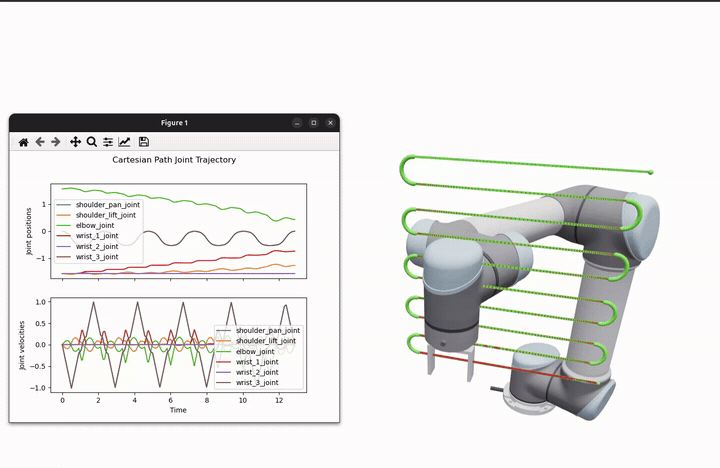

Cartesian Planning
==================

The ``roboplan_cartesian_planning`` package traces a Cartesian path in joint space using the :ref:`OInK <oink-solver>` optimal IK solver.

   Cartesian path planning with a UR5 arm.

Approach
--------

The planner builds an arc-length SE(3) reference from the waypoints (linear interpolation for position, SLERP for orientation), and then works in two stages.

**Stage 1 — resolve.**
The reference is sampled by arc length, at a density set by the path tolerance and exactly at every sharp corner, and one OInK differential-IK problem is solved *to convergence* at each sample, seeded from the previous solution.
Because every sample is driven well inside the path tolerance before the reference advances, the resolved joint path never trails the reference, so there is no feedrate throttling or lag recovery.
If IK cannot converge at some sample (e.g., near a singularity or against a joint limit), the planner returns an error naming where it failed.
The result is purely geometric and carries no timing.
Joint **position** limits are enforced inside the QP; a ``VelocityLimit`` is also applied there, but only to cap how far a single IK iteration may move (``dt`` times the joint velocity limit).

**Stage 2 — time.**
Both speed modes respect the robot's joint **velocity and acceleration** limits, and differ in how they time the resolved path:

- ``TimeOptimal``: decimates the resolved path to its shape-carrying waypoints and time-parameterizes it with :doc:`TOPP-RA <trajectory_generation>`,
  over a straight-segment + circular-blend geometry.
  ``toppra_blend_deviation`` bounds how far, in joint-space units, a rounded corner may stray from the sharp one.
  The result is time-optimal under the joint limits, so the tool speed varies along the path.
- ``Bounded``: gives the tool a trapezoidal speed profile, speeding up, holding a constant speed, and slowing down at the commanded Cartesian maxima
  (``max_linear_speed`` / ``max_angular_speed`` and ``max_linear_acceleration`` / ``max_angular_acceleration``).
  The path is split into runs at its sharp corners, where the tool stops, while a finely sampled curve flows through its waypoints.
  The tool also slows down, at the same bounded acceleration, wherever the joint limits require it, so the commanded values act as **maxima**, not fixed values.

Both modes return a ``JointTrajectory``.
``computePeakLimitRatios`` returns the trajectory's peak velocity/acceleration-to-limit ratios, showing how close the result is to the joint limits, and ``computeAchievedPathLength`` returns the Cartesian distance traced by the tip frames.
Use ``Bounded`` for a predictable, smooth Cartesian motion, and ``TimeOptimal`` when time-optimality matters.

Multiple end effectors
----------------------

A ``CartesianPath`` may contain more than one end-effector frame.
The planner builds one tracking ``FrameTask`` per frame and advances all of them along a shared normalized path parameter, so the motions are traced simultaneously.
The convergence check uses the worst-case error across all frames, and ``computeAchievedPathLength`` sums the Cartesian distance across them.

Customizing the IK problem
--------------------------

By default the planner builds its own OInK solver.
This solver has one ``FrameTask`` per end-effector plus a nullspace ``ConfigurationTask``.
It is bounded by ``VelocityLimit`` and ``PositionLimit`` constraints based on the robot joint limits.

To control the differential-IK problem yourself, construct the planner with a ``CartesianPlannerComponents`` supplying:

- ``oink``: the :ref:`OInK <oink-solver>` solver instance.
- ``tracking_tasks``: one ``FrameTask`` per end-effector, ordered to match the path's tip frames.
- ``extra_tasks``: additional tasks (e.g., a custom nullspace posture task).
- ``constraints`` and ``barriers``: any constraints/control barrier functions to apply at every step.

The planner reuses these objects across all ``plan()`` calls and never mutates them apart from the tracking-task targets.
Any seed-dependent setup is the caller's responsibility.
In this mode, the OInK-related fields of ``CartesianPlannerOptions`` (costs, gains, limits) are ignored.
However, the timing/tolerance fields (``dt``, speeds, ``*_tolerance``, ``speed_mode``, scales) still apply.
