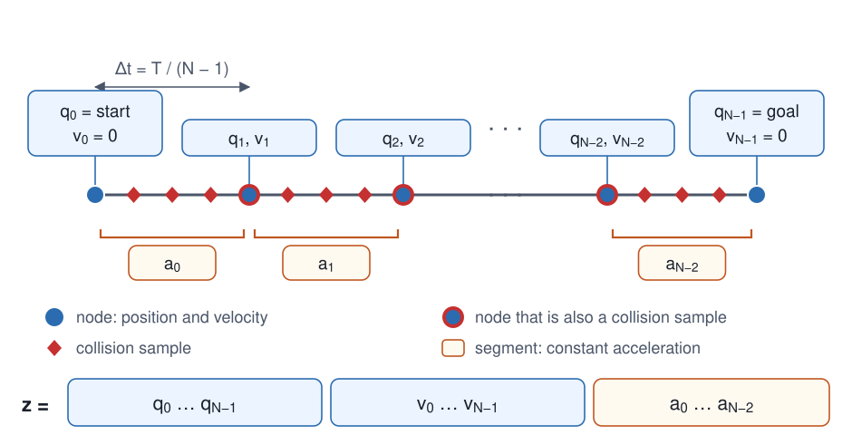
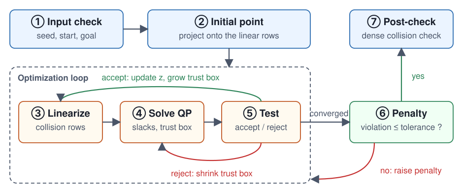
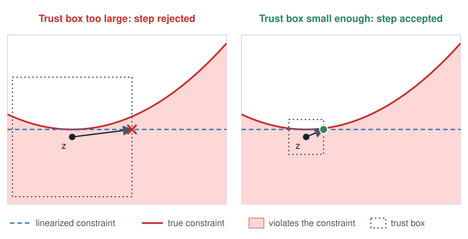

Vex: Sequential Convex Trajectory Optimization
==============================================

``Vex`` turns a seed path into a trajectory of fixed duration that starts and ends at rest, respects the ``Scene``'s joint limits, and keeps a minimum distance on every active collision pair.
It is offline and kinematic, and does not retime the result.

TL;DR
-----

- The trajectory is a finite set of variables: position and velocity at :math:`N` nodes, and one constant acceleration per segment between nodes.
- Dynamics, joint limits and boundary conditions are linear in these variables. Only collision avoidance is nonconvex.
- Collision constraints are linearized at the current trajectory, which gives a quadratic program (QP). The QP is solved inside a trust box, and the step is accepted only if the real decrease of cost plus penalty is at least ``improve_ratio`` times the decrease the QP predicted.
- Collision violations are penalized with a weight that grows by a fixed factor whenever the loop has converged with violations left.

Background
----------

An :doc:`RRT </concepts/sampling_based_planning>` path is collision-free but long and jerky, and :doc:`shortcutting </concepts/path_shortcutting>` only cuts corners along straight segments.
Trajectory optimization instead treats the whole trajectory as variables and minimizes a cost on velocity and acceleration subject to constraints.

Collision avoidance makes this problem nonconvex.
Sequential convex programming (SCP) handles it by repeating three steps: approximate the problem by a convex one around the current solution, solve it, and check how good the approximation was.
The loop follows `TrajOpt <https://doi.org/10.1177/0278364914528132>`_ (Schulman et al., 2014): an ℓ1 exact penalty on the linearized collision violation, a box trust region, a shrink and expand rule on the ratio of actual to predicted decrease, and a penalty that grows when the loop has converged with violations left.
The ratio and the stopping criterion are those of SCvx in `Malyuta et al. (2021) <https://arxiv.org/abs/2106.09125>`_ (eq. 62 and 65), and the ℓ1 penalty is their eq. 48 and 49. Vex uses a single acceptance threshold instead of the four-case update rule of SCvx (their Fig. 16).
The same tutorial describes GuSTO, which replaces the hard trust box and the slack variables by soft penalties. Vex does not use it.

Transcription
-------------

   The trajectory is :math:`N` nodes spaced by :math:`\Delta t`. Each node holds :math:`(q_k, v_k)`, each segment a constant :math:`a_k`. All variables are stacked into one vector :math:`z`. Three collision samples per segment are drawn, the default.

The duration :math:`T` is fixed, so the nodes are :math:`\Delta t = T / (N - 1)` apart.
For :math:`n` joints in the group, the optimization variable is

.. math::

   z = (q_0, \ldots, q_{N-1},\; v_0, \ldots, v_{N-1},\; a_0, \ldots, a_{N-2}) \in \mathbb{R}^{(3N-1)\,n}

Inside segment :math:`k`, for :math:`t \in [0, \Delta t]`, velocity is linear and position quadratic in time:

.. math::

   v_k(t) = v_k + a_k t, \qquad q_k(t) = q_k + v_k t + \tfrac{1}{2} a_k t^2

The trajectory can therefore be evaluated at any time between two nodes, which is used for the collision samples.

Problem Formulation
^^^^^^^^^^^^^^^^^^^

.. math::

   \begin{aligned}
   \min_z \quad & \tfrac{1}{2} z^\top P z && \text{smoothness cost} \\
   \text{s.t.} \quad & A z = b && \text{dynamics and boundary conditions} \\
   & l \le G z \le u && \text{joint limits} \\
   & g(z) \le 0 && \text{collision avoidance}
   \end{aligned}

Where:

- **Smoothness cost.** The integral of the weighted squared velocity and acceleration, computed exactly:

  .. math::

     \tfrac{1}{2} z^\top P z = \int_0^T w_v \|v(t)\|^2 + w_a \|a(t)\|^2 \, dt

  The velocity term shortens the path, the acceleration term smooths it. :math:`P` is sparse and positive semidefinite.

- **Dynamics and boundary conditions.** For every segment

  .. math::

     q_{k+1} = q_k + v_k \Delta t + \tfrac{1}{2} a_k \Delta t^2, \qquad v_{k+1} = v_k + a_k \Delta t

  and at the ends :math:`q_0 = q_{\text{start}}`, :math:`q_{N-1} = q_{\text{goal}}`, :math:`v_0 = v_{N-1} = 0`.

- **Joint limits.** Position, velocity (:math:`\pm v_{\max}`) and acceleration (:math:`\pm a_{\max}`) limits of the ``Scene`` at the nodes. Velocity is linear on a segment, so the node bounds hold along it.

- **Collision avoidance.** One row per active collision pair and collision sample (the red markers in the figure). The signed distance :math:`\operatorname{sd}_p` of pair :math:`p` must stay above :math:`d_{\text{safe}}`:

  .. math::

     g_i(z) = d_{\text{safe}} - \operatorname{sd}_p\big(q_k(t)\big) \le 0

  This is the only nonconvex part.

.. list-table::
   :header-rows: 1
   :class: comparison-table
   :widths: 25 75

   * - Symbol
     - Description
   * - :math:`N`, :math:`T`, :math:`\Delta t`
     - Number of nodes, duration, node spacing :math:`T/(N-1)`
   * - :math:`n`
     - Number of joints in the group
   * - :math:`q_k, v_k, a_k`
     - Position and velocity at node :math:`k`, acceleration on segment :math:`k`
   * - :math:`z`
     - Stacked optimization variable
   * - :math:`P`, :math:`w_v`, :math:`w_a`
     - Cost Hessian, velocity weight, acceleration weight
   * - :math:`A, b`
     - Dynamics and boundary rows
   * - :math:`G, l, u`
     - Joint limit rows and bounds
   * - :math:`g(z)`, :math:`J_g`
     - Collision rows and their Jacobian :math:`\partial g / \partial z`
   * - :math:`d_{\text{safe}}`, :math:`d_{\text{check}}`
     - Required clearance; distance below which a pair gets a row
   * - :math:`\operatorname{sd}_p(q)`
     - Signed distance of collision pair :math:`p` in configuration :math:`q`
   * - :math:`\Delta z`, :math:`s`, :math:`x`
     - Step and slack variables of the QP, and the QP variable :math:`x = (\Delta z, s)`
   * - :math:`\eta`
     - Trust box radius
   * - :math:`\lambda`
     - Penalty weight on collision violation
   * - :math:`\phi`, :math:`m`
     - Merit function and its QP model
   * - :math:`\rho`
     - Ratio of actual to predicted decrease of the merit
   * - :math:`S`
     - Variable scaling, :math:`z = S y`; the QP is solved in :math:`y`

Solving
-------

   Stages ① and ② build a starting point. Stages ③ to ⑤ repeat until the step test converges. Stage ⑥ decides between finishing and raising the penalty. Stage ⑦ checks the result between the collision samples.

① Input Check
^^^^^^^^^^^^^

``Vex::solve`` (``vex.cpp``) returns an error, without optimizing, for invalid input, for a start or goal outside the joint limits, and for a start or goal whose signed distance on any active pair is below ``collision_margin``.
The last case includes collision. ``hasCollisions`` backs up the distances, because coal reports mesh-mesh distances unsigned.
The trajectory begins and ends at start and goal, so a margin row there could never be satisfied.
Joints with :math:`n_q \ne n_v` (continuous, floating) are not supported.

② Initial Point
^^^^^^^^^^^^^^^

The loop starts from a point :math:`z_0` that satisfies the dynamics, boundary and limit rows (:math:`A`, :math:`G`) up to solver tolerance; only the collision rows may be violated.
A seed path has no velocities or accelerations and ignores the duration and the limits, so it cannot be used directly.
``resampleSeed`` resamples it to :math:`N` nodes, uniformly in arc length. ``resampleUniform`` only downsamples, so each seed segment is first subdivided linearly.
``projectOntoConstraints`` (``convex_problem.cpp``) then finds the trajectory closest to the resampled positions that satisfies the linear rows:

.. math::

   \min_z \; \sum_{k=0}^{N-1} \|q_k - q_k^{\text{seed}}\|^2 \quad \text{s.t.} \quad A z = b, \; l \le G z \le u

If this QP is infeasible, no trajectory of duration :math:`T` satisfies the boundary conditions and limits (for example, the duration is too short for the distance), and ``solve`` returns an error.

③ Linearize
^^^^^^^^^^^

``CollisionTerm`` (``collision_term.cpp``) evaluates :math:`g(z)` and its Jacobian :math:`J_g(z)` at the current :math:`z`.

**Samples.**
Collision is checked at the interior nodes :math:`1 \ldots N-2` and at ``samples_per_segment`` equally spaced times inside every segment.
Start and goal are fixed and were checked in ①.

**Rows.**
At a sample, every active pair with :math:`\operatorname{sd}_p < d_{\text{check}}` gives one row :math:`g_i`.
Pairs farther apart than :math:`d_{\text{check}}` are left out to keep the QP small.
If a step moves such a pair closer, the rows evaluated at the new point in ⑤ include it, and its violation raises the true merit and lowers :math:`\rho`.

**Jacobian.**
:math:`q_k(t)` depends on :math:`q_k`, :math:`v_k` and :math:`a_k`, so with :math:`\nabla_q \operatorname{sd}_p` from ``SceneContext::computeDistanceJacobian``, restricted to the group's joints:

.. math::

   \frac{\partial g_i}{\partial (q_k, v_k, a_k)} = -\big(1,\; t,\; \tfrac{1}{2} t^2\big) \otimes \nabla_q \operatorname{sd}_p

At a node (:math:`t = 0`) only the :math:`q_k` block is nonzero; all other entries of the row are zero.

④ Solve the QP
^^^^^^^^^^^^^^

``assembleSubproblem`` (``scp.cpp``) builds a QP for the step :math:`\Delta z` around the current :math:`z`.
Two additions make the linearized problem well posed:

- A **trust box** :math:`\eta` limits the step to the region where the linearization is accurate (see ⑤).
- A **slack** :math:`s_i \ge 0` per collision row absorbs the violation of its linearization, at cost :math:`\lambda` per unit. This keeps the QP feasible when a row cannot be satisfied inside the box.

With :math:`x = (\Delta z, s)`:

.. math::

   \min_{x} \quad \tfrac{1}{2} x^\top H x + c^\top x, \qquad
   H = \begin{bmatrix} P & 0 \\ 0 & 0 \end{bmatrix}, \qquad
   c = \begin{bmatrix} P z \\ \lambda \mathbf{1} \end{bmatrix}

Subject to:

.. math::

   \begin{array}{ll}
   A \Delta z = b - A z & \text{dynamics, boundary} \\[4pt]
   l - G z \le G \Delta z \le u - G z & \text{joint limits} \\[4pt]
   J_g \Delta z - s \le -g(z), \quad s \ge 0 & \text{linearized collision, slack} \\[4pt]
   \| S^{-1} \Delta z \|_\infty \le \eta & \text{trust box}
   \end{array}

Where:

- The objective equals :math:`\tfrac{1}{2}(z + \Delta z)^\top P (z + \Delta z) + \lambda \sum_i s_i` up to a constant: the cost of the new trajectory plus the penalty.
- The linear rows are written in the step, so they hold exactly for :math:`z + \Delta z`.
- :math:`S = \operatorname{diag}(I,\; \Delta t^{-1} I,\; \Delta t^{-2} I)` rescales :math:`z = S y` so that :math:`q`, :math:`v \Delta t` and :math:`a \Delta t^2` have the same unit (position). The trust box then reads :math:`|\Delta q| \le \eta`, :math:`|\Delta v|\,\Delta t \le \eta`, :math:`|\Delta a|\,\Delta t^2 \le \eta`, so one radius fits all three blocks.
- The implementation solves the QP in :math:`y` and divides the objective by :math:`\lambda`. The minimizer is the same, and the problem is better conditioned.
- The joint-limit rows and the trust box bound the same variables, so the implementation sends one bound row per variable with the intersection of both. This removes about 38% of the inequality rows. The QP solve gets about 10% faster and the whole solve 2–6%.
- At the optimum :math:`s_i = \max(0,\, g_i + J_{g,i} \Delta z)`, so :math:`\lambda \sum_i s_i` is the ℓ1 penalty of the linearized violation.
- Collision rows with a numerically zero gradient (pairs the group cannot move) are constant under the step. They get no slack and no QP row, but still count in the merit and in the violation check.

⑤ Test
^^^^^^

The QP only knows the linearization.
``ScpLoop::trustRegionStep`` compares its prediction with the true constraints, using the merit function

.. math::

   \phi(z) = \underbrace{\tfrac{1}{2} z^\top P z}_{\text{cost}} + \lambda \underbrace{\sum_i \max\big(0,\, g_i(z)\big)}_{\text{collision violation}}

and its QP model, which replaces :math:`g(z + \Delta z)` by its linearization:

.. math::

   m(\Delta z) = \tfrac{1}{2} (z + \Delta z)^\top P (z + \Delta z) + \lambda \sum_i \max\big(0,\, g_i(z) + J_{g,i} \Delta z\big)

Both sums run over all collision rows, including those left out of the QP.
The ratio of the actual to the predicted decrease is

.. math::

   \rho = \frac{\text{actual decrease}}{\text{predicted decrease}} = \frac{\phi(z) - \phi(z + \Delta z)}{\phi(z) - m(\Delta z)}

   The linearized constraint (dashed) touches the true one (red) near :math:`z` and drifts away from it with distance. In a large box the step can land where the linearization is wrong, so the actual decrease is far below the predicted one and :math:`\rho` is small. In a small box the two agree and :math:`\rho` is close to 1. A step that lands in a slightly violated region can still be accepted if the merit decreases enough.

After each QP solve the conditions are checked in this order:

.. list-table::
   :header-rows: 1
   :class: comparison-table
   :widths: 35 65

   * - Condition
     - Action
   * - predicted decrease below ``tolerance``
     - The QP model predicts a decrease of the merit below ``tolerance``. Converged for this :math:`\lambda`.
   * - :math:`\rho \ge` ``improve_ratio``
     - Accept: :math:`z \leftarrow z + \Delta z`, multiply :math:`\eta` by ``trust_expand``. Go to ③ with the rows already evaluated at the new :math:`z`.
   * - otherwise
     - Reject: multiply :math:`\eta` by ``trust_shrink`` and go back to ④. Converged if :math:`\eta <` ``tolerance``.
   * - the QP fails
     - Shrink :math:`\eta` and retry. ``QpFailure`` if the ``Scene`` has no active collision pair, or if :math:`\eta <` ``tolerance`` afterwards.

Every QP solve counts toward ``max_iterations``, accepted or not.

⑥ Penalty
^^^^^^^^^

When ⑤ converges, ``ScpLoop::run`` checks the largest collision violation:

.. math::

   \max\big(0,\, g_1(z), \ldots, g_m(z)\big) \le \text{tolerance}

If it holds, the status is ``Converged``.
Otherwise the penalty was too weak to remove the violation: :math:`\lambda` is multiplied by ``penalty_increase`` and the loop runs again, up to ``max_penalty_increases`` times.
After that the status is ``ConvergedInfeasible``.
The trust box is kept for the next round, raised to at least ``1.5 * tolerance / trust_shrink`` if it had collapsed, so that the first rejected step of the new round does not end it.

⑦ Post-Check
^^^^^^^^^^^^

The collision rows only constrain the samples.
``isContinuousCollisionFree`` (``collision_term.cpp``) checks the trajectory in between.
On each segment it bounds the speed of every joint by :math:`\max(\|v_k\|_\infty, \|v_{k+1}\|_\infty)` and checks as many equally spaced configurations as needed so that no group joint moves more than 0.01 rad (or m) between two checked configurations.
It tests for contact only, not for ``collision_margin``. The result is ``VexResult.continuous_collision_free``, independent of the status.

Configuration
-------------

``VexOptions``. Joint limits are read from the ``Scene``. The defaults for the penalty, the trust box and the ratio test follow Tesseract's ``trajopt_sqp``.

.. list-table::
   :header-rows: 1
   :class: comparison-table
   :widths: 24 60 16

   * - Parameter
     - Description
     - Default
   * - ``group_name``
     - Name of the joint group to optimize. Required.
     - none
   * - ``num_nodes``
     - Number of nodes :math:`N` (at least 3). More nodes allow a finer trajectory but make every QP larger and slower.
     - 50
   * - ``samples_per_segment``
     - Collision samples inside each segment, besides the nodes. The higher, the less likely a collision between two nodes goes unnoticed, at the cost of more collision rows. 0 checks only the nodes.
     - 3
   * - ``velocity_weight``
     - Weight :math:`w_v` on squared velocity. The higher relative to ``acceleration_weight``, the shorter and more direct the path.
     - 1.0
   * - ``acceleration_weight``
     - Weight :math:`w_a` on squared acceleration. The higher, the smoother the speed profile.
     - 1e-2
   * - ``collision_margin``
     - Clearance :math:`d_{\text{safe}}` in meters that every collision pair must keep. Start and goal must already have it.
     - 0.01
   * - ``collision_check_distance``
     - Distance :math:`d_{\text{check}}` in meters below which a pair enters the QP. The higher, the earlier obstacles are taken into account, at the cost of more rows. Must exceed ``collision_margin``.
     - 0.05
   * - ``initial_penalty``
     - Initial :math:`\lambda`. The higher, the more a collision violation costs compared to path length and smoothness.
     - 10
   * - ``penalty_increase``
     - Factor by which :math:`\lambda` grows when the loop converged with violations left. Larger factors usually need fewer rounds to clear them.
     - 10
   * - ``max_penalty_increases``
     - Number of increases before giving up with ``ConvergedInfeasible``.
     - 5
   * - ``initial_trust_box``
     - Initial :math:`\eta`, in rad or m. The higher, the larger the first steps. If too large, steps are rejected until the box has shrunk.
     - 0.1
   * - ``trust_shrink``
     - Factor on :math:`\eta` after a rejected step. The lower, the faster the box shrinks, but steps may become needlessly small.
     - 0.1
   * - ``trust_expand``
     - Factor on :math:`\eta` after an accepted step. The higher, the faster the box recovers after having been shrunk.
     - 1.5
   * - ``improve_ratio``
     - Minimum :math:`\rho` to accept a step. The higher, the more accurate the linearization must be, and the more steps are rejected.
     - 0.25
   * - ``max_iterations``
     - Maximum number of QP solves in the loop. Rejected steps count too.
     - 50
   * - ``max_time``
     - Wall-time limit of the loop in seconds, checked before every QP solve.
     - ∞
   * - ``tolerance``
     - Threshold for collision violation, predicted decrease and trust box size. Lower values typically need more iterations.
     - 1e-4

With the defaults, :math:`\lambda` takes the values :math:`10, 10^2, \ldots, 10^6`.

Result
------

``VexResult`` holds the ``trajectory`` (a ``JointTrajectory`` over the group joints with :math:`t_k = k \Delta t`), ``status``, ``iterations`` (number of QP solves), ``cost`` :math:`= \tfrac{1}{2} z^\top P z`, ``max_violation`` (the largest collision violation from ⑥), and ``continuous_collision_free``. Positions and velocities at start and goal are set to their exact values.

.. list-table::
   :header-rows: 1
   :class: comparison-table
   :widths: 28 72

   * - ``VexStatus``
     - Meaning
   * - ``Converged``
     - ⑤ converged and the largest collision violation is within ``tolerance``.
   * - ``ConvergedInfeasible``
     - Converged, but collision violations remain after ``max_penalty_increases`` increases.
   * - ``MaxIterations``
     - ``max_iterations`` QP solves reached.
   * - ``QpFailure``
     - A QP failed and either the ``Scene`` has no active collision pair (there is no trust box to shrink) or shrinking the trust box brought it below ``tolerance``.
   * - ``Timeout``
     - ``max_time`` exceeded.

``Converged`` is a statement about the samples. ``continuous_collision_free`` adds that no checked configuration between them is in contact; it does not mean the margin holds there.

Implementation Notes
--------------------

- The QPs are solved with the sparse `ProxQP <https://github.com/Simple-Robotics/proxsuite>`_ solver, wrapped in ``qp_backend.cpp``, the only file that includes proxsuite. The solver is rebuilt for every QP because the number of rows changes between iterations. The primal warm start is :math:`\Delta z = 0` with the smallest feasible slacks.
- The ProxQP settings are tuned for these QPs, measured on collision QPs with about 1400 variables and 2900 inequality rows:

  - The initial inequality proximal parameter ``mu_in`` is 1e-3 instead of ProxQP's 1e-1. With the default the solver spends most of its time in ``mu_in`` updates, each of which updates the sparse LDLT for every inequality row. The solve time drops from about 1.6 s to about 0.04 s with the same solution.
  - The primal infeasibility threshold ``eps_primal_inf`` is 1e-12 instead of 1e-4. The subproblem is feasible by construction (:math:`\Delta z = 0` with :math:`s = \max(0, g)`), yet the default threshold reported primal infeasibility on about 1 in 20 subproblems and the tighter one never did.
  - Dividing the objective by :math:`\lambda` keeps the dual variables of order 1. Without it ProxQP needed hundreds of iterations at :math:`\lambda \ge 10^2` and reported primal infeasibility at :math:`10^5` to :math:`10^6`.

- A collision row is treated as constant under the step if its gradient norm is at most 1e-9. On the UR5 with gripper, pairs the group cannot move had gradient norms below 1e-15, and the smallest movable ones were many orders of magnitude above 1e-9.
- The projection QP of ② adds a weight of 1e-6 on velocity and acceleration, so that its Hessian is not singular on blocks that the equality rows already determine.
- A QP has :math:`(3N-1)\,n` variables plus one slack per collision row. The signed distances dominate the cost per iteration, so accepted steps reuse the rows evaluated for the test.
- Without active collision pairs the QP model is exact: no trust box is used and the first accepted step is the optimum.
- ``solve`` uses its own ``SceneContext`` and never modifies the ``Scene``. Use one ``Vex`` per thread.

Limitations
-----------

- Only vector-space joints (:math:`n_q = n_v`) are supported.
- The duration is fixed by the caller. For a time-optimal trajectory, apply :doc:`/concepts/trajectory_generation` to the resulting positions.
- Collision is constrained only at the samples and verified by the post-check, which reports but does not repair.
- Position limits are enforced at the nodes. Velocity and acceleration bounds hold along a segment, but position is quadratic between nodes and can leave its limits there.
- The signed distance is only piecewise smooth, the penalty weight is raised in steps instead of being fixed, and the update rule differs from SCvx. The SCvx convergence guarantee (Malyuta et al., Theorem 8, which assumes linearly independent constraint gradients, a sufficiently large fixed penalty and smooth constraints) therefore does not apply. Vex gives no convergence guarantee.

Usage Example
-------------

.. code-block:: python

   from roboplan.vex import Vex, VexOptions, VexStatus

   options = VexOptions()
   options.group_name = "arm"
   options.collision_margin = 0.02
   vex = Vex(scene, options)

   # `path` is a JointPath, e.g. the output of rrt.plan(start, goal).
   result = vex.solve(start, goal, 5.0, path)
   if result.status == VexStatus.Converged and result.continuous_collision_free:
       trajectory = result.trajectory  # a JointTrajectory with N nodes, not retimed

``solve`` raises ``RuntimeError`` for invalid input, an endpoint below ``collision_margin``, or an infeasible boundary-condition problem.

``roboplan_examples/python/example_rrt.py --vex`` runs vex after RRT and shows the resulting trajectory.
